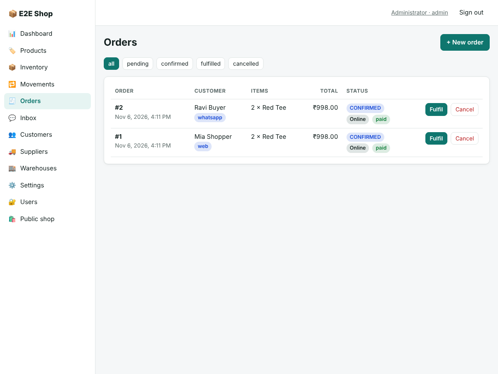

# StockSync — Inventory Management with WhatsApp & Social Ordering

StockSync is a full inventory management platform. It has a **web dashboard** (also installable on phones as an app), a **public shop website**, and **WhatsApp, Facebook Messenger, Instagram and Telegram** integration, and it runs on **Microsoft Azure**.

| Dashboard (live) | Public shop |
|---|---|
|  |  |

| Orders with payment status (web + WhatsApp, paid online) |
|---|
|  |

## Features
- **Inventory:** products with SKU, price, image and **custom fields you define** (size, colour, batch…), categories, multiple warehouses, receive/issue/adjust/transfer, and a full movement ledger. Stock can never go negative, even under concurrent orders.
- **Orders:** from staff, the website, or chat. Confirming deducts stock atomically and cancelling restocks it. Customers are notified on their own chat channel.
- **Chat commerce:** customers send `catalog`, `stock TEE`, `price TEE`, `order TEE 2` or `status 12` on any channel. Staff see every conversation in a shared **Inbox** and can reply.
- **Tap-to-order (new):** customers say "hi" and tap through *Browse → category → product → quantity → cart → checkout* with real **WhatsApp buttons and list menus** (Telegram inline buttons, Messenger/Instagram quick replies, numbered text elsewhere). A saved cart, "My orders" and order status work the same way.
- **Payments (new):** **Razorpay** Payment Links — pay online (UPI, cards, netbanking) from the shop or with a **Pay** button in chat, or choose cash on delivery. Orders are confirmed automatically when the signed webhook arrives; amounts are always computed on the server; shoppers can resume or renew a payment from their order page. Paid-but-unfulfillable, duplicate and cancelled-after-paid payments are flagged for refund with staff alerts, and staff record refunds with one click.
- **Live dashboard:** KPIs, reorder list, pending orders and a realtime activity feed (Server-Sent Events).
- **Low-stock alerts:** sent to staff on WhatsApp or Telegram the moment a product crosses its reorder level.
- **Fully dynamic:** business name, currency, default warehouse, alert recipients and custom product fields all change at runtime from **Settings**.
- **Roles:** admin / staff / viewer.
- **Safe by design:** signed webhooks, idempotent processing, abuse limits (15 open orders per customer, rate limits), a security regression suite, and a browser end-to-end test — see [docs/7_SECURITY_AUDIT.md](docs/7_SECURITY_AUDIT.md).
- **Azure:** Container Apps, Container Registry, PostgreSQL Flexible Server, Blob Storage (direct browser uploads), Key Vault, Application Insights. Infrastructure as code in `infra/main.bicep`, with CI/CD via GitHub Actions + OIDC.

## Quick start
```bash
docker compose up --build        # → http://localhost:3005  (admin@example.com / ChangeMe123!)
```
Deploy to Azure: **[docs/DEPLOYMENT_GUIDE.md](docs/DEPLOYMENT_GUIDE.md)**.

## Development
```bash
npm install
npm run dev                                          # API :8080 + web :5173
npm run typecheck && npm run lint && npm test        # quality gate (needs PostgreSQL, see guide)
npm run build && npm run e2e                         # browser end-to-end: shop → pay → confirmed, WhatsApp tap flow (needs Playwright, see guide §6)
```

## Project docs (AI engine SDLC memory)
`docs/1_PRD.md` · `2_ARCHITECTURE.md` · `3_SCHEMAS.md` · `4_TASKS.md` · `6_STATE_SUMMARY.md` · `7_SECURITY_AUDIT.md` · `DEPLOYMENT_GUIDE.md`

Engine rules for AI assistants: `.github/copilot-instructions.md`, `.clinerules`.
